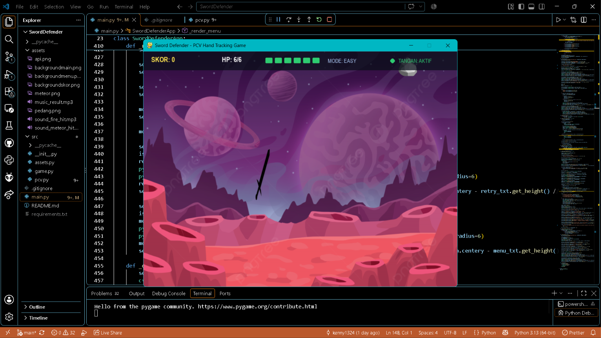

# Sword Defender — Game Pertahanan Pedang Interaktif (PCV)

Game pertahanan interaktif berbasis Pengolahan Citra dan Video (PCV) yang dimainkan secara langsung menggunakan gerakan tangan di depan webcam.

Pemain mengendalikan bilah pedang di layar permainan. Dengan menggerakkan tangan secara bebas di udara, pemain menangkis meteor dan bola api yang berjatuhan dari atas layar sebelum menyentuh dasar benteng pertahanan.

---

## Dokumentasi Visual

### Screenshot Gameplay
<!-- SLOT GAMBAR SCREENSHOT: Letakkan file tangkapan layar game pada folder docs/screenshot.png -->


> *Catatan: Letakkan file tangkapan layar game pada folder `docs/screenshot.png` atau unggah langsung gambar tangkapan layar ke repository ini.*

---

### Video Dokumentasi Gameplay
<!-- SLOT VIDEO DOKUMENTASI: Letakkan file rekaman gameplay pada folder docs/gameplay.mp4 -->
<video src="docs/gameplay.mp4" controls="controls" width="100%"></video>

[Tonton atau Unduh File Video Gameplay](docs/gameplay.mp4)

> *Catatan: Letakkan file rekaman video permainan pada folder `docs/gameplay.mp4` atau unggah langsung file video MP4 ke repository ini.*

---

## Tahapan Lengkap Pengolahan Citra dan Video (PCV)

Bagian ini menjelaskan secara rinci seluruh tahapan matematis dan algoritma pemrosesan citra digital yang digunakan, mulai dari penerimaan sinyal visual mentah dari webcam hingga menghasilkan koordinat titik pusat tangan (centroid) untuk menggerakkan pedang.

```
+-----------------------------------------------------------------------+
| 1. Akuisisi Frame Kamera (Format BGR)                                |
+-----------------------------------------------------------------------+
                                  |
                                  v
+-----------------------------------------------------------------------+
| 2. Pembalikan Horizontal Citra (Horizontal Mirroring)                 |
+-----------------------------------------------------------------------+
                                  |
                                  v
+-----------------------------------------------------------------------+
| 3. Konversi Ruang Warna dari BGR ke HSV                               |
+-----------------------------------------------------------------------+
                                  |
                                  v
+-----------------------------------------------------------------------+
| 4. Segmentasi Warna Kulit (Dual-Range HSV Thresholding)               |
+-----------------------------------------------------------------------+
                                  |
                                  v
+-----------------------------------------------------------------------+
| 5. Operasi Morfologi Manual NumPy (Opening & Closing 3x3)             |
+-----------------------------------------------------------------------+
                                  |
                                  v
+-----------------------------------------------------------------------+
| 6. Analisis Komponen Terhubung DFS 4-Arah (Connected Components)      |
+-----------------------------------------------------------------------+
                                  |
                                  v
+-----------------------------------------------------------------------+
| 7. Perhitungan Centroid (Pusat Massa) & Penapisan Area                |
+-----------------------------------------------------------------------+
                                  |
                                  v
+-----------------------------------------------------------------------+
| 8. Pemetaan Skala Koordinat & Peredaman Getaran (Smoothing EMA)       |
+-----------------------------------------------------------------------+
                                  |
                                  v
                        [ Koordinat Pedang ]
```

---

### 1. Akuisisi Frame Kamera dan Pembalikan Horizontal (Mirroring)
- Kamera membaca aliran video secara berkala pada resolusi 640 x 480 piksel per frame.
- Frame yang baru ditangkap memiliki susunan piksel bawaan OpenCV dalam format BGR (Blue, Green, Red).
- Citra dibalik secara horizontal menggunakan fungsi refleksi sumbu Y:
  ```text
  I_flip(x, y) = I_raw(Lebar - 1 - x, y)
  ```
  Pembalikan ini penting agar interaksi terasa alami seperti menghadap cermin: ketika pemain menggerakkan tangan ke arah kanan fisiknya, objek di layar juga bergerak ke kanan.

---

### 2. Konversi Ruang Warna: Mengapa dari BGR/RGB ke HSV?
Secara visual, citra digital standar tersusun atas tiga kanal warna dasar: Red, Green, dan Blue. Namun, ruang warna RGB/BGR memiliki kelemahan mendasar dalam analisis citra:
- **Keterikatan Intensitas Cahaya**: Pada RGB, corak warna (*chrominance*) bercampur langsung dengan intensitas cahaya (*luminance*). Jika pencahayaan ruangan meredup atau timbul bayangan, ketiga nilai R, G, dan B akan berubah drastis, sehingga segmentasi warna kulit mudah gagal.
- **Pemisahan Karakteristik pada HSV**:
  Ruang warna HSV memisahkan informasi visual menjadi tiga dimensi independen:
  1. **Hue (H)**: Corak atau panjang gelombang warna murni. Pada OpenCV 8-bit, nilainya dipetakan ke rentang 0 hingga 179 (mewakili sudut lingkaran warna 0 derajat sampai 360 derajat).
  2. **Saturation (S)**: Kemurnian atau kejenuhan warna (rentang 0 sampai 255), dari warna abu-abu pudar hingga warna pekat murni.
  3. **Value (V)**: Tingkat kecerahan atau intensitas cahaya (rentang 0 sampai 255), dari gelap pekat (hitam) hingga terang maksimal.

Dengan memisahkan intensitas cahaya (V) dari corak warna (H), sistem dapat mendeteksi warna kulit secara konsisten meskipun intensitas cahaya di ruangan berfluktuasi atau terdapat bayangan ringan pada tangan.

---

### 3. Segmentasi Warna Kulit (Dual-Range Thresholding)
Pigmen hemoglobin darah dan melanin pada kulit manusia memiliki corak warna alami yang berada di sekitar spektrum merah.

Pada model lingkaran warna Hue (0–179 di OpenCV):
- Warna merah murni berada pada sudut 0 derajat dan 180 derajat (titik pertemuan lingkaran).
- Karena itu, rentang corak kulit manusia terbagi menjadi dua kelompok di sekitar nilai batas tersebut:
  - **Rentang Pertama (Nilai Hue Rendah)**:
    - Batas Bawah: `[0, 30, 60]`
    - Batas Atas: `[20, 255, 255]`
  - **Rentang Kedua (Nilai Hue Tinggi mendekati 180)**:
    - Batas Bawah: `[160, 30, 60]`
    - Batas Atas: `[180, 255, 255]`

Setiap piksel diuji terhadap kedua rentang tersebut untuk menghasilkan mask biner:
- Piksel yang masuk dalam Rentang Pertama bernilai 255 (putih), selain itu 0 (hitam).
- Piksel yang masuk dalam Rentang Kedua bernilai 255 (putih), selain itu 0 (hitam).

Kedua mask biner digabungkan menggunakan operasi logika bitwise OR:
```text
Mask_Gabungan = Mask_Rentang1 OR Mask_Rentang2
```

Hasil akhir tahap ini adalah citra biner hitam-putih di mana piksel bernilai 255 (putih) mewakili area yang terdeteksi sebagai kulit, dan 0 (hitam) mewakili latar belakang.

---

### 4. Operasi Morfologi Biner Manual Menggunakan NumPy
Citra biner hasil thresholding masih mengandung ketidaksempurnaan berupa bintik-bintik derau (*noise*) di latar belakang dan rongga lubang di dalam telapak tangan. Untuk memperbaikinya, diterapkan operasi morfologi matematika menggunakan struktur kernel persegi 3 x 3 dengan penambahan batas nol (*zero-padding*).

Operasi ini diimplementasikan murni menggunakan operasi array NumPy:

#### A. Erosi (Erosion 3x3)
Piksel keluaran bernilai foreground (255) jika dan hanya jika **seluruh 9 piksel tetangga** dalam jendela kernel 3 x 3 bernilai foreground (> 0). Jika ada minimal satu tetangga bernilai 0, maka piksel keluaran menjadi 0.
- **Fungsi**: Mengikis tepi luar objek, memotong jembatan piksel tipis, dan melenyapkan bintik-bintik putih terisolasi yang berasal dari pantulan cahaya kecil di latar belakang.

#### B. Dilasi (Dilation 3x3)
Piksel keluaran bernilai foreground (255) jika **minimal satu piksel tetangga** dalam jendela kernel 3 x 3 bernilai foreground (> 0).
- **Fungsi**: Memperluas batas luar objek putih, menyambungkan kembali bagian tangan yang terputus sebagian, dan menutup lubang-lubang kecil.

#### C. Operasi Opening dan Closing
- **Opening** (Erosi diikuti Dilasi):
  ```text
  Opening(Mask) = Dilasi(Erosi(Mask))
  ```
  Berfungsi menghilangkan derau tonjolan tipis dan bintik kecil di latar belakang tanpa mengubah ukuran keseluruhan tangan.
- **Closing** (Dilasi diikuti Erosi):
  ```text
  Closing(Mask) = Erosi(Dilasi(Mask))
  ```
  Berfungsi menutup rongga lubang di bagian tengah telapak tangan sehingga bentuk tangan menjadi padat (*solid*).

---

### 5. Analisis Komponen Terhubung Menggunakan Algoritma DFS 4-Arah
Setelah citra biner dibersihkan, langkah berikutnya adalah memisahkan pulau-pulau piksel putih yang berdiri sendiri dan mencari komponen yang merupakan tangan pemain.

1. **Downscaling Citra**: Untuk menjamin pemrosesan berjalan realtime 60 FPS di laptop tanpa lag, citra biner diperkecil ke ukuran 160 x 120 piksel.
2. **Matriks Kunjungan (Visited)**: Dibuat matriks boolean berukuran 160 x 120 bernilai `False`.
3. **Penelusuran Depth-First Search (DFS)**:
   - Program memindai citra dari pojok kiri atas.
   - Ketika ditemukan piksel foreground (bernilai 255) yang belum pernah dikunjungi, piksel tersebut dijadikan titik awal penelusuran DFS.
   - Menggunakan struktur data *stack* eksplisit (bukan rekursi fungsi agar tidak melampaui batas *call stack* Python), program menelusuri seluruh tetangga yang saling terhubung.
4. **Konektivitas 4-Arah (4-Neighborhood)**:
   Tetangga yang diperiksa adalah 4 arah ortogonal: Atas, Bawah, Kiri, dan Kanan:
   ```text
   Arah = [(-1, 0), (1, 0), (0, -1), (0, 1)]
   ```
5. **Akumulasi Luas dan Koordinat Komponen**:
   Selama proses penelusuran satu komponen, program menghitung:
   - Jumlah total piksel penyusun komponen (`Area`).
   - Jumlah koordinat horizontal (`Sum_X`) dan vertikal (`Sum_Y`).
6. **Penapisan Area (Area Filtering)**:
   Komponen disaring menggunakan ambang batas:
   ```text
   MIN_AREA <= Area <= MAX_AREA
   ```
   - Nilai `MIN_AREA = 35`: Menyingkirkan derau bintik kecil yang tersisa.
   - Nilai `MAX_AREA = 8000`: Menyingkirkan area latar belakang berukuran besar (misalnya jika seluruh dinding berwarna krem).
   - Komponen valid dengan nilai `Area` terbesar dipilih sebagai objek tangan pemain.

---

### 6. Perhitungan Titik Pusat Massa (Centroid)
Setelah komponen tangan terbesar ditemukan, titik pusat massa matematis (*centroid*) dihitung menggunakan rumus momen spasial:

```text
Centroid_X = Sum_X / Area
Centroid_Y = Sum_Y / Area
```

Keterangan:
- `Area` adalah jumlah total piksel tangan terpilih.
- `Sum_X` adalah penjumlahan koordinat X dari seluruh piksel penyusun tangan tersebut.
- `Sum_Y` adalah penjumlahan koordinat Y dari seluruh piksel penyusun tangan tersebut.

Hasil pasangan `(Centroid_X, Centroid_Y)` ini merupakan titik tengah geometris dari telapak tangan pemain pada ruang resolusi citra pemrosesan.

---

### 7. Pemetaan Skala Koordinat dan Peredaman Gerakan (Smoothing)

#### A. Pemetaan Koordinat ke Layar Game
Titik pusat yang diperoleh masih berada pada skala resolusi pemrosesan (160 x 120). Titik ini dipetakan secara proporsional ke resolusi layar permainan (800 x 600):

```text
X_layar = (Centroid_X / 160) * 800
Y_layar = (Centroid_Y / 120) * 600
```

Koordinat dibatasi (*clamping*) agar posisi pedang selalu berada di dalam batas tampilan layar.

#### B. Peredaman Getaran (Exponential Moving Average / EMA)
Gerakan tangan manusia dan fluktuasi pencahayaan antarfram dapat menimbulkan getaran kecil (*jitter*). Untuk menghasilkan gerakan pedang yang halus, diterapkan interpolasi eksponensial:

```text
Posisi_Baru = (alpha * Posisi_Target) + ((1 - alpha) * Posisi_Sebelumnya)
```

dengan koefisien `alpha = 0.35`. Nilai ini memberikan keseimbangan optimal antara respon gerakan yang cepat dan stabilitas pedang yang tenang.

#### C. Penanganan Kehilangan Tangan (Timeout)
Jika pemain menarik tangannya keluar dari jangkauan kamera:
- Sistem tidak memindahkan pedang secara acak ke pojok layar, melainkan menahan posisi valid terakhir.
- Timer kehilangan tangan dihitung. Jika tangan tidak terdeteksi lebih dari 0,6 detik, bilah pedang dinonaktifkan (ditampilkan pudar) dan tabrakan dinonaktifkan agar tidak terjadi penangkisan pasif secara tidak sengaja.

---

## Mekanisme Permainan dan Aturan Skor

Tujuan utama pemain adalah mempertahankan benteng dari serangan meteor dan api selama mungkin serta mengumpulkan skor setinggi-tingginya.

### Sistem HP (Health Points)
- Pemain memiliki 6 HP pada awal permainan.
- HP ditampilkan melalui bilah visual kotak di panel atas layar (HUD).
- Jika HP habis mencapai 0, benteng pertahanan dinyatakan runtuh dan permainan memasuki layar Game Over.

### Aturan Tangkisan dan Konsekuensi
Tangkisan terjadi murni berdasarkan perpotongan kotak pembatas (*bounding box collision*) antara bilah pedang dan objek yang sedang jatuh:

| Objek | Karakteristik | Efek Saat Tertangkis Pedang | Efek Saat Lolos ke Batas Bawah |
| :--- | :--- | :--- | :--- |
| **Meteor** | Berupa bongkahan batu angkasa | Skor bertambah 1, HP tidak berkurang, memutar efek suara meteor | Mengurangi 1 HP pemain |
| **Api** | Berupa bola api menyala | Skor bertambah 2, HP tidak berkurang, memutar efek suara api | Mengurangi 2 HP pemain |

Setiap objek jatuh hanya diproses tepat satu kali: objek yang sudah ditangkis langsung dihancurkan dan tidak dapat menimbulkan kerusakan pada frame berikutnya.

---

## Tingkat Kesulitan (Difficulty Modes)

Tingkat kesulitan dapat dipilih langsung dari Menu Utama sebelum menekan tombol PLAY:

- **EASY**: Interval kemunculan objek relatif longgar (~1,5 detik) dengan kecepatan jatuh lambat dan peluang kemunculan api 20%.
- **MEDIUM**: Interval kemunculan objek sedang (~1,0 detik) dengan kecepatan jatuh menengah dan peluang kemunculan api 30%.
- **HARD**: Interval kemunculan objek sangat rapat (~0,6 detik) dengan kecepatan jatuh tinggi dan peluang kemunculan api 35%.

Tingkat kesulitan bersifat tetap selama satu sesi permainan dan tidak dinaikkan secara otomatis berdasarkan perolehan skor.

---

## Navigasi Menu dan Tampilan Game

1. **PLAY**: Memulai sesi permainan dengan tingkat kesulitan yang dipilih. Kamera yang telah aktif langsung digunakan tanpa jeda inisialisasi ulang.
2. **DEMONSTRATION (PCV)**: Membuka panel diagnostik realtime yang menampilkan 5 tahapan pemrosesan kamera secara langsung:
   - Panel 1: Kamera Asli (RGB Mirrored)
   - Panel 2: Mask Thresholding HSV Kulit
   - Panel 3: Hasil Morfologi Opening
   - Panel 4: Hasil Morfologi Closing
   - Panel 5: Hasil DFS Connected Component dan Titik Pusat Tangan (Centroid)
   - Panel 6: Telemetri data realtime (Status deteksi, koordinat layar, luas piksel komponen, ambang HSV, dan FPS).
3. **MODE (EASY / MEDIUM / HARD)**: Mengganti mode permainan yang akan digunakan saat menekan PLAY.
4. **EXIT**: Menutup aplikasi serta melepaskan resource kamera, audio, dan jendela secara bersih.
5. **GAME OVER**: Menampilkan skor akhir yang dicapai, tombol PLAY AGAIN untuk mengulang seketika dengan mode yang sama, dan tombol MAIN MENU untuk kembali ke menu awal.

---

## Kontrol Permainan

- **Gerakan Tangan (Webcam)**: Mengendalikan posisi pedang ke segala arah untuk menangkis meteor dan api.
- **Klik Kiri Mouse**: Menavigasi tombol antarmuka pada Menu Utama dan Layar Game Over.
- **Tombol Keyboard ESC**: Kembali ke Menu Utama saat berada di layar gameplay atau demonstrasi PCV.

---

## Struktur Direktori Project

```text
SwordDefender/
├── .gitignore           # Konfigurasi pengabaian file Git
├── main.py              # Entry point utama program dan pengelolaan alur layar
├── README.md            # Dokumentasi lengkap mekanisme dan metode PCV
├── assets/              # Berkas media gambar dan suara
│   ├── pedang.png
│   ├── meteor.png
│   ├── api.png
│   ├── backgroundmenu.png
│   ├── backgroundmain.png
│   ├── backgroundskor.png
│   ├── music_result.mp3
│   ├── sound_meteor_hit.mp3
│   └── sound_fire_hit.mp3
└── src/                 # Modul logika game dan pengolahan citra
    ├── __init__.py
    ├── pcv.py           # Pipeline PCV, segmentasi HSV, morfologi manual, dan DFS
    ├── game.py          # Logika entitas objek jatuh, pedang, dan collision
    └── assets.py        # Pengelola pemuatan aset gambar dan audio dengan caching
```

---

## Panduan Instalasi dan Menjalankan Game

1. Pastikan perangkat terhubung dengan webcam fungsional dan memiliki Python versi 3.9 ke atas.
2. Pasang pustaka dependensi yang dibutuhkan:
   ```bash
   pip install opencv-python numpy pygame
   ```
3. Jalankan aplikasi melalui terminal:
   ```bash
   python main.py
   ```
4. Pastikan pencahayaan ruangan cukup terang dan merata untuk hasil pelacakan tangan yang maksimal.
